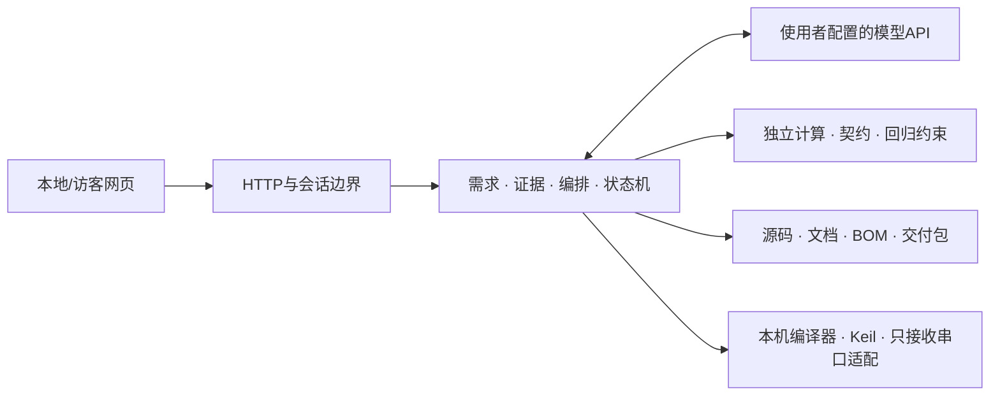

# Embedded Engineer Agent

语言需求 → 工程约束 → 方案与证据 → 源码和设计文档 → 可追溯的验证记录。

开发中的嵌入式工程Agent，提供**本地运行版 + 自备API的网页部署版**，共用Python工程核心。MIT开源。当前为预览版本，不是已完成实机验收的自动硬件设计产品。

## 两个版本

| | 本地版 | 网页部署版 |
|---|---|---|
| 分析、对话、方案、源码与文档生成 | 支持 | 支持 |
| 模型API | 使用者配置；Windows DPAPI加密保存 | 访客配置DeepSeek；密钥仅在会话内存使用 |
| 项目 | 保存在自己的runtime目录 | 隔离访客会话，8小时有效，须及时导出 |
| 编译与测试 | 使用已配置的本机工具，记录实际结果 | 无隔离执行器，不执行生成代码 |
| Keil | 可信工程副本导入、修改、构建 | 不访问访客电脑的Keil |
| 实物连接 | 设备发现、明确授权后的只接收串口日志 | 不访问服务器或访客硬件 |
| 烧录与自动实机验收 | **尚未接入** | **尚未接入** |

网页版是邀请式会话预览，没有账户注册、长期云盘或跨设备恢复。GitHub托管源码不会自动运行Python后端，不能用GitHub Pages直接代替在线工作台。

## 本地开始

需要Python 3.11+；Windows是当前本地工具与密钥存储的主要环境。

```powershell
python -m venv .venv
.\.venv\Scripts\python -m pip install -e .
.\.venv\Scripts\python -m embedded_agent.server --port 8786
```

打开 <http://127.0.0.1:8786/>，创建项目，在“修改模型/API”填写自己的密钥。保存不调用模型；连接测试、对话和自动推进会计费。可选串口依赖：`pip install -e ".[hardware]"`。Keil、ARMCC、MSVC及设备驱动由使用者自行安装，仓库不附带。

## 网页部署

见[在线入口](ONLINE-START-HERE.md)和[Docker Compose / HTTPS部署说明](deploy/README.md)。需要自己的服务器、域名、访问口令；无需开发者提供共享模型密钥。当前仅允许DeepSeek官方API，联网资料执行器尚未接入在线部署。无开发板也可以分析和生成草案。

## 功能与边界

- 需求、约束、验收、条件式方案与必要的用户确认。
- 动作契约、任务编排、真实工具回执、有界修复、幂等及恢复。
- 本地资料检索、受控原厂资料扩展和参数核对；具体部署可禁用联网。
- 独立单位计算及有限范围的一致性检查，不是通用自然语言语义证明。
- C模块、接口/连接草案、详细产品设计文档、BOM和交付物导出。
- 本机工具编译、Keil副本构建、主机断言和诊断；软件结果与硬件结果分别记录。
- 用量、缓存、按角色计费与金额保护。默认每日10元保护；匿名会话统计不代表服务商账户的全局支出。

模型分析、人工修正和案例重放须区分。源码生成不等于器件核实，编译通过不等于实机通过。没有宣称完成烧录、电气验证、整机续航或安全认证。容器启动、HTTPS和公网部署需在实际服务器验证。

## 测试与贡献

Windows离线测试，不需要真实模型密钥：

```powershell
$env:PYTHONPATH="src;tests"
python -m unittest discover -s tests
```

工具/平台相关测试的跳过情况以实际输出为准。`tools/`中标注`--live`的测试会调用自己的模型并计费，不在离线回归中。历史迁移工具须自行提供项目编号及运行资料，不是通用一键入口。

见[贡献指南](CONTRIBUTING.md)、[安全说明](SECURITY.md)、[第三方说明](THIRD_PARTY_NOTICES.md)。本地主机执行适用于可信工程，不是恶意代码沙箱。不要把个人本地端口直接暴露到公网。

## 结构



`src/embedded_agent/`为共享核心和界面；`deploy/`为当前网页版配置；`deployments/agentarts/`为历史平台适配器；`tests/`、`examples/`、`tools/`提供回归和工具；`knowledge/index.json`是自编方法卡与注明出处的参考摘要，不含下载手册。

[架构与编排图](docs/Agent架构与编排设计.md)及其他`docs/`文档保留日期与阶段性说明；历史结论不能覆盖当前代码与新测试。发行内容不包含密钥、预算数据库、私人项目/聊天、厂商下载文件或编译器安装内容。
