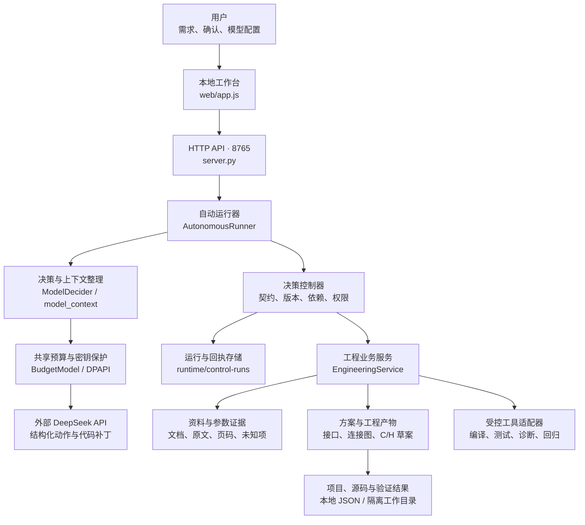
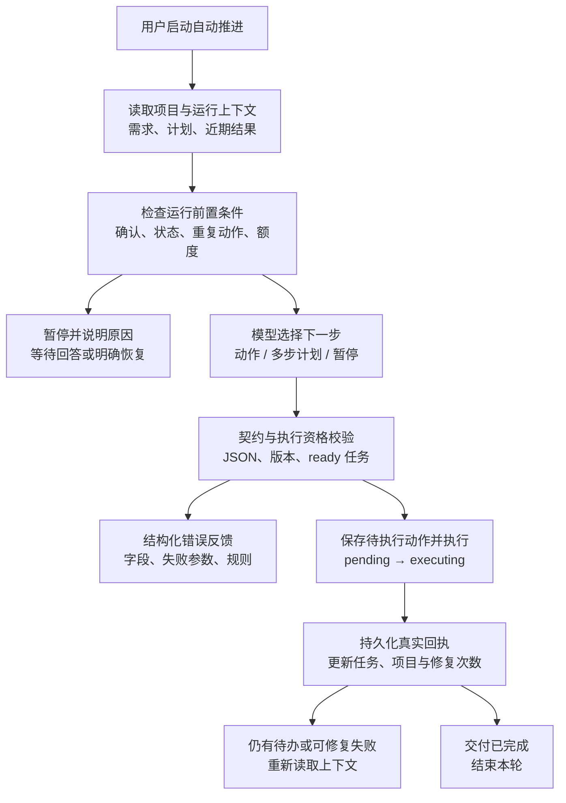
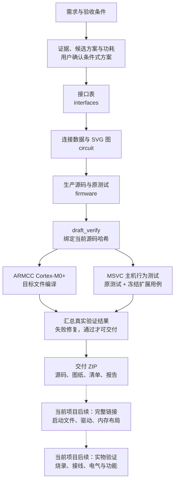
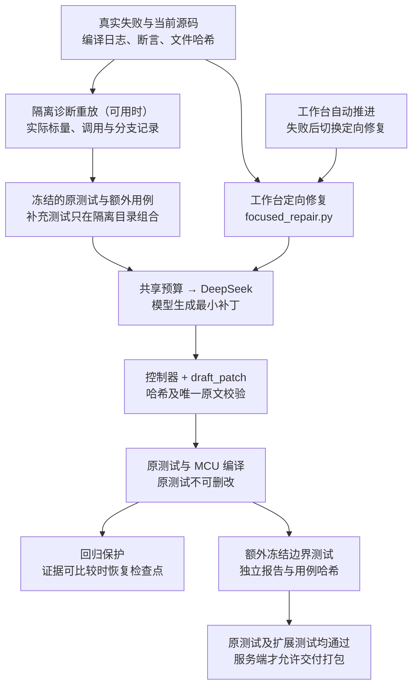
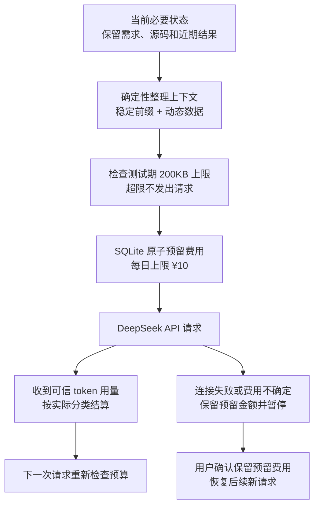
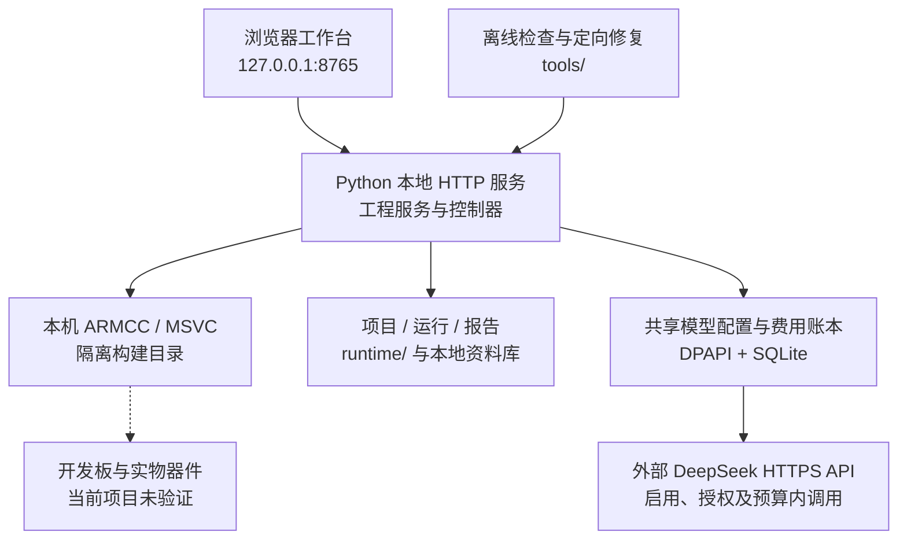

# Embedded Engineer Agent：架构、构建与编排

更新：2026-10-18。依据当前源码整理；图中绿色为已实现模块，蓝色为外部模型服务，黄色与虚线为待接入或当前项目未执行部分。

当前不是多模型 Agent 集群。“训练”指诊断反馈、测试用例与修复流程完善，没有训练模型权重。

## 1. 总体架构图

模型负责提出动作；控制器负责约束；工具提供真实执行结果。当前是单模型驱动的本地工程系统。

箭头表示主要调用方向；模型响应和工具回执沿调用链返回。密钥不进入项目文件或浏览器返回值。

## 2. 决策与任务编排图

每一步依据当前项目与真实回执推进；没有新输入时不会通过反复调用模型解除暂停。

左侧错误反馈和底部待办均可回到“读取上下文”，前提是预算与重试次数允许。用户确认和未知费用暂停不会由模型自行解除。

## 3. 工程产物构建与验证图

把工程草案、对象编译、主机行为测试、完整链接和实物验收分开记录。

连接图是工程草案，不是可生产 PCB。当前机器人完成的是对象编译与 mock 测试；完整固件链接、烧录和硬件验收未执行。

## 4. 诊断与定向修复图

工作台已接入定向修复与冻结扩展测试；独立脚本保留用于诊断演练。

失败回馈下一轮模型修复。诊断重放不是原测试结果；回归恢复不是对任意改动的无条件保证。已关联测试集的源码哈希及测试集哈希均通过后，服务端 execute 才允许交付。

## 5. 费用与上下文控制图

按人民币预算控制，缓存输入、非缓存输入和输出分别计费，不换算成固定 token 数。

恢复不重放失败请求、不退还未知费用预留。缓存前缀只提高命中机会；实际命中以 API 用量为准。本地限额不涵盖同一密钥在其他客户端的花费。

## 6. 本地部署与数据分布图

当前运行路径是 Windows 本地服务；Docker 和 AgentArts 托管不在本轮工作路径中。

文件存储适合当前本地单进程场景，不代表多用户事务或云平台部署。联网搜索和实时报价不能因存在接口模块就视为已接入。

## 模块与实际入口

| 职责 | 实现 |
|---|---|
| 工作台、HTTP、进度 | `src/embedded_agent/server.py`、`src/embedded_agent/web/app.js` |
| 普通自动决策 | `autonomy.py`、`decision_protocol.py`、`model_context.py` |
| 控制、计划、契约和限制 | `control.py`、`planning.py`、`contracts.py`、`runtime_policy.py` |
| 工程业务和工具注册 | `service.py`、`application.py`、`adapters.py` |
| 资料、方案、参数、功耗 | `library.py`、`design.py`、`selection.py`、`power.py` |
| 草案、验证、诊断、回归 | `draft.py`、`draft_verification.py`、`assertion_diagnostics.py`、`repair_coach.py`、`draft_regression.py` |
| 额外测试隔离组合 | `supplemental_tests.py` |
| 本地模型与共享预算 | `local_model.py` |
| 项目存储与交付判定 | `storage.py`、`readiness.py` |
| 独立定向修复 | `tools/run_focused_repair.py` |
| 边界审计与离线回归 | `tools/check_robot_boundaries.py`、`tools/run_offline_curriculum.py` |

表内未写目录的 Python 文件均在 `src/embedded_agent/`。旧 `Workflow / StageAgent` 线性骨架保留，主要用于需求入口；其中阶段占位对象不等于当前工作台所有阶段的执行器。

## 当前验证范围

2026-10-17 的机器人版本已通过原始 mock 测试与新增八类边界用例，并通过 Cortex-M0+ 对象编译；源码、验证结果与交付包按哈希核对。该结果只针对该版本及已有用例，不证明任意工程都能独立完成。完整固件链接、实物验证、电气审查保持未执行。

已验证交付记录：`runtime/focused-repair/20261017-220108/verified-summary.json`。边界审计：`runtime/boundary-audit/20261017-220353/report.json`。不把这些历史记录称为对后续版本的持续有效认证。

## 已有步骤的下一步完善

1. 已接入工作台：失败时定向生成单文件补丁，复测、打包与结束由程序确定性调度。
2. 已接入服务端门禁：已关联冻结测试集的项目必须同时通过原测试与扩展测试，旧报告不能解锁交付。
3. 统一主机编译日志编码，减少中文乱码。
4. 持续补充跨项目边界用例，验证恢复、费用限制与已通过行为。

2026-10-18 更新：上述两项接入已完成，已用离线替身流程和当前项目真实编译复测验证；不据此宣称模型通用独立能力。日志编码与跨项目覆盖继续完善。
