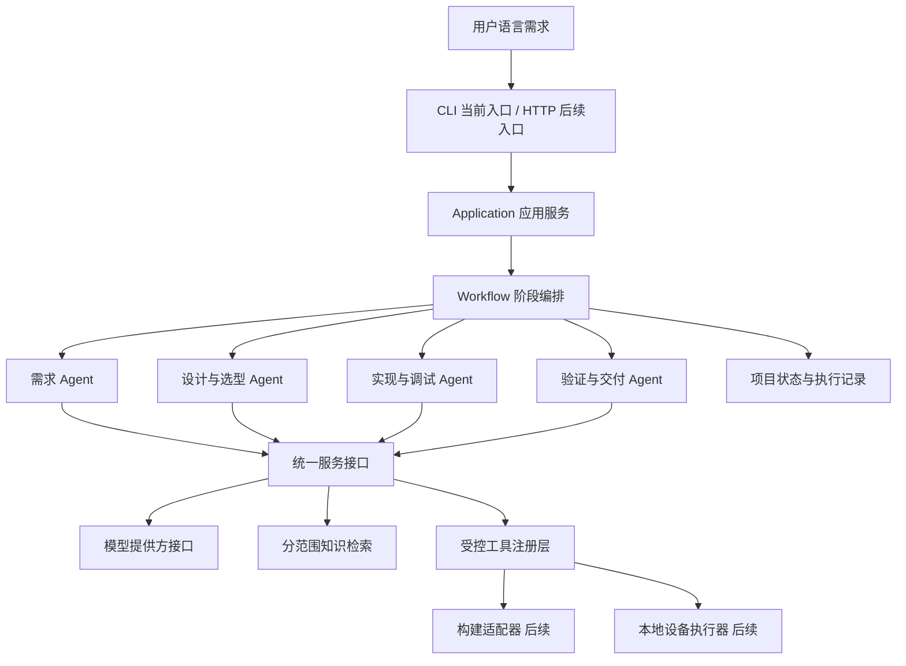

> 历史文档：保留2026-10-14初始设计，不代表当前实现状态。当前入口见 ../Agent架构与编排设计.md。

# 通用嵌入式 Agent 整体架构

目标是接收自然语言需求，形成有依据的候选方案，通过平台适配器实施工程，并依据实际验证结果交付。
当前交付为可运行的单进程架构骨架，不是已经支持任意芯片的完整平台。



## 模块职责

| 模块 | 实现位置 | 当前能力 |
|---|---|---|
| 领域数据 | domain.py | 项目、阶段、产物、结果与事件 |
| 外部接口 | ports.py | 模型、知识、工具、Agent 契约 |
| 编排 | workflow.py | 单步执行、停止、保存、显式重试 |
| Agent | analysis.py / agents.py | 需求提取、检索、方案比较及输出检查；其他阶段为占位 |
| 知识适配 | adapters.py | 当前知识索引的范围过滤与关键词检索 |
| 工具适配 | adapters.py | 工具注册、参数验证、结果格式和精简调用记录 |
| 项目存储 | storage.py | 本地 JSON 持久化、UUID 路径限制、文件替换 |
| 应用服务 | application.py | 组合模块、注册工具、注入模型 |
| 入口 | cli.py | 创建、查看、执行、重试、检索和能力列表 |

原有 tools/ 下的脚本保留独立使用。知识索引已接入；案例导入脚本尚未注册为 Agent 工具。

## 流程与契约

阶段顺序：需求 → 设计 → 选型 → 实现 → 构建 → 调试 → 验证 → 交付。
当前是线性骨架；调试阶段后续根据构建与验证结果条件进入，修复后返回受影响阶段。

结果状态：passed、needs_input、unsupported、failed。
只有通过且提供产物才推进阶段；其他状态保持当前位置。等待输入不重复执行。
失败或缺少能力允许显式重试；等待确认必须通过后续的用户输入接口解决，不能由模型自报 confirmed 跳过。

需求 Agent 当前要求模型返回 requirements、constraints、assumptions、questions 和 search_queries 列表。
每项需求包含 id、description、acceptance、origin。检索后调用模型比较候选方案，结果保持草稿并等待用户确认。
model.py 已提供可配置的 Chat Completions 适配器；不绑定模型名，无配置时不使用固定模板伪装分析。
详细配置与补充需求入口见 `通用需求分析入口.md`。

阶段产物后续约定：
- design：候选方案、约束比较、架构、接口、风险、证据。
- selection：器件、适用版本、兼容性依据、未知项。
- implementation：源码快照、修改与接口关联。
- build：工具链、真实工具结果、日志、产物哈希。
- debug：现象、假设、排查、修改、复测。
- verification：需求与测试映射、执行环境、预期、实际、证据。
- delivery：版本、文件清单、已验证范围和未解决问题。

当前仅实现需求输出检查。其余阶段的专属验证器、确认接口、变更失效规则、工具日志持久化与产物文件管理仍待实现。

## 可扩展位置

新增模型：实现 ModelProvider 并注入 Application，不修改芯片适配器。
新增阶段 Agent：实现 StageAgent，注册到 Workflow；必须增加专属阶段验证规则。
新增构建工具：实现参数校验、执行器和结果契约，注册到 ToolRegistry。明确工作区、超时、产物和权限。
新增芯片：添加资料、能力与构建/烧录适配，不修改需求和通用知识层。
新增项目：创建独立状态与案例配置，不把项目功能写死进编排器。

## 部署边界

第一版采用标准库和文件存储，便于先验证接口与流程，无需启动数据库和联网服务。
文件存储只适用于本地单进程，不承诺并发事务；多用户版本改用数据库和作业队列。
HTTP、身份认证、密钥管理、后台任务和设备授权在对外部署前实现。
本架构不开放任意 shell，不执行资料附件，也不自动购买、烧录或配置不可逆设备选项。

## 启动和验证

在项目根目录设置 PYTHONPATH 为 src 后：

```text
python -m embedded_agent.cli capabilities
python -m embedded_agent.cli create --description "设计一个能检测门窗状态并提醒用户的设备"
python -m embedded_agent.cli show PROJECT_ID
python -m embedded_agent.cli step PROJECT_ID
python -m embedded_agent.cli search --query 需求
python -m unittest discover -s tests -v
```

当前 step 将如实返回模型未配置，项目仍停留在需求阶段。
测试中的模型和阶段替身仅验证架构行为，不代表实际项目完成了设计或构建。
